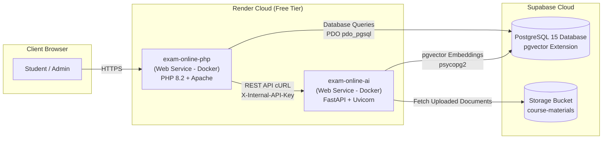

# AI-Powered Online Examination & Personalized Learning System

> A production-oriented Full-Stack Online Examination and AI Engineering Platform featuring secure exam proctoring, automated question generation, human-in-the-loop admin review, question-specific focused study notes, machine-learning question difficulty evaluation, Retrieval-Augmented Generation (RAG) study assistance with strict subject isolation, student performance analytics, code execution sandbox, and personalized adaptive learning.

---

> [!IMPORTANT]
> **Branch & Deployment Status Notice**
> The latest deployment stabilization, dynamic health check port binding, and non-blocking model warm-up fixes currently reside on the **`audit/deployment-fixes`** branch. These changes have **not** been merged into `main`, and live cloud redeployment has not been triggered.

---

## 1. Project Overview

The **AI-Powered Online Examination & Personalized Learning System** integrates a comprehensive PHP 8.2 web management application with an asynchronous Python 3.10 FastAPI AI microservice. It provides educational institutions with an end-to-end platform to create, manage, and proctor online examinations, while providing students with automated performance diagnostics, RAG-powered course material study assistance, interactive code execution sandboxing, and personalized adaptive practice sessions.

The system emphasizes deterministic boundaries, AI safety guards, human-in-the-loop oversight, and strict subject isolation to eliminate cross-subject hallucination and retrieval leakage.

---

## 2. Main Features

### Core Examination & Administration
- **Exam Management**: Create timed examinations with custom durations, passing marks, and customizable question banks.
- **Proctoring & Violation Tracking**: Real-time client-side detection of tab switching, window blurring, and unauthorized navigation with persistent violation logging.
- **Instant Result Evaluation**: Automated score tabulation, per-question breakdown, and performance review.
- **Multi-Role Access Control (RBAC)**: Distinct permissions and views for Administrators and Students.
- **Authentication & Security**: Session fixation defense (`session_regenerate_id`), CSRF security tokens, password hashing (`PASSWORD_BCRYPT`), and secure email-delivered OTP password reset.

### AI Engineering & Learning Assistant
- **Automated Question Generation**: Generates 4-option MCQs and multi-type questions complete with answer keys and academic explanations using LLM completions or rule-based heuristic fallbacks.
- **Human-in-the-Loop Admin Review**: Generated questions enter a dedicated staging queue (`pending`). Administrators can review, edit, approve into active question pools, or reject with feedback notes.
- **Question-Specific Focused Study Notes**: Provides concept-specific revision notes for individual exam questions, explicitly flagging whether the content is grounded in uploaded course materials or generated via curriculum knowledge.
- **Machine Learning Question Difficulty Evaluation**: Scikit-Learn models assess empirical student interaction metrics (attempt counts, correct ratios, distinct students, question readability) with cold-start guards ($< 3$ attempts) to recommend calibrated difficulty ratings.
- **Deterministic Student Analytics**: Aggregates topic mastery into `Strong` ($\ge 80\%$), `Developing` ($50\% - 79.9\%$), and `Weak` ($< 50\%$) categories and tracks score trajectories over time.
- **Personalized Recommendations & Adaptive Practice**: Generates targeted study plans and weakness-focused practice sessions that operate independently from official exam records.
- **RAG-Powered AI Study Assistant**: Students query an interactive assistant for explanations grounded in course materials (PDF, TXT, MD) with exact filename and page-number citations.
- **Strict Subject Isolation**: Enforces query boundaries so that specific subject queries (e.g., *GK*, *English*, *Java*, *Operating Systems*) never leak into unrelated documents or performance records.
- **Interactive Code Execution Sandbox**: In-browser coding playground supporting Python, C, C++, Java, and JavaScript with timeout enforcement and test case validation.

---

## 3. Technology Stack

### Web Application & Core Backend
- **Language**: PHP 8.2 / 8.1
- **Server**: Apache HTTP Server (with `mod_rewrite` and `mod_headers`)
- **Database Abstraction**: Custom dual-driver abstraction in [`config/db.php`](config/db.php):
  - **Local Development**: MySQL / MariaDB via native **MySQLi** (`mysqli_connect`, prepared statements).
  - **Cloud Deployment**: Managed PostgreSQL on Supabase via PHP Data Objects (**PDO** with `pdo_pgsql`), wrapped in `PgSqlDbAdapter` and `PgSqlStmtAdapter` to provide full API compatibility with existing MySQLi application code.
- **Frontend**: HTML5, Vanilla CSS3 (custom design system, responsive layouts), Vanilla JavaScript (Fetch API, AJAX).

### AI Microservice & Data Science
- **Language**: Python 3.10
- **Web Framework**: FastAPI (ASGI), Uvicorn, Pydantic v2 (`pydantic-settings`)
- **Machine Learning**: Scikit-Learn (Random Forest, Logistic Regression), NumPy, Joblib
- **RAG & Vector Embeddings**:
  - **Embedding Model**: `BAAI/bge-small-en-v1.5` (384-dimensional dense vectors)
  - **Inference Runtime**: FastEmbed (ONNX runtime for low-memory CPU execution) with fallback to `sentence-transformers`
  - **Document Processing**: PyPDF for text extraction, chunking with sliding-window token overlap
  - **Vector Storage**:
    - *Local Development*: Persistent **ChromaDB** (`ai-service/data/chroma_db`)
    - *Cloud Production*: PostgreSQL with **`pgvector`** extension (`ai_document_chunks` table using cosine distance operator `<=>`)
- **HTTP Client Bridge**: cURL-based bridge in [`config/ai_client.php`](config/ai_client.php) with shared internal API key authentication (`X-Internal-API-Key` and `X-API-Key`).

---

## 4. Project Folder Structure

```text
online-exam-system/
├── admin/                        # Administrator views & control workflows
│   ├── ai_difficulty_analytics.php # ML question difficulty review
│   ├── ai_question_generator.php   # AI question generation staging
│   ├── exams.php                 # Exam scheduling, creation, and deletion
│   ├── manage_course_materials.php # PDF/TXT/MD upload and RAG indexing
│   ├── questions.php             # Question bank management
│   └── review_ai_questions.php   # Human-in-the-loop approval queue
├── ai-service/                   # Python FastAPI AI Microservice
│   ├── app/
│   │   ├── config.py             # Settings & environment variable configuration
│   │   ├── main.py               # FastAPI entrypoint & background warmup
│   │   ├── auth.py               # Internal API key authentication dependency
│   │   ├── ml/                   # Scikit-Learn models & feature extractors
│   │   ├── routes/               # REST API route handlers
│   │   │   ├── code_execution.py # Sandbox runner for code execution
│   │   │   ├── health.py         # Liveness & healthcheck endpoints
│   │   │   ├── ml_difficulty.py  # Empirical difficulty prediction
│   │   │   ├── performance.py    # Student analytics & trajectory calculation
│   │   │   ├── question_gen.py   # AI MCQ and focused notes generation
│   │   │   ├── rag.py            # Document ingestion, search & assistant Q&A
│   │   │   └── recommendations.py# Adaptive study plan generation
│   │   ├── schemas/              # Pydantic request and response models
│   │   └── services/             # Core service logic (RAGService, LLMService, SubjectDetector)
│   ├── Dockerfile                # AI service container definition
│   ├── requirements.txt          # Python library dependencies
│   └── tests/                    # 103 Pytest unit and integration tests
├── assets/                       # Static stylesheets, icons, and JavaScript
├── auth/                         # Authentication modules (login, logout, register, OTP reset)
├── config/                       # Configuration modules & shared utilities
│   ├── ai_client.php             # HTTP cURL bridge to FastAPI service
│   ├── db.php                    # Dual-driver database abstraction (MySQL / PDO PostgreSQL)
│   ├── env_loader.php            # Environment variable reader with fallback
│   ├── mailer.php                # Outbound SMTP / Brevo transactional email helper
│   ├── subject_resolver.php      # Subject extraction and query routing
│   └── text_helpers.php          # Markdown renderer and text sanitizer
├── database/                     # Database schemas and versioned migrations
│   ├── migrations/               # Incremental schema patches
│   ├── online_exam_system.sql    # Baseline MySQL / MariaDB schema
│   └── schema_postgres.sql       # PostgreSQL schema with pgvector table definitions
├── docs/                         # Architecture guides, audit notes, and deployment specs
├── student/                      # Student portal views
│   ├── ai_performance.php        # Visual analytics and topic mastery
│   ├── dashboard.php             # Enrolled exams and active notices
│   ├── exam_result.php           # Post-exam score breakdown
│   ├── personalized_learning.php # Weakness analysis and study plans
│   ├── practice_session.php      # Adaptive practice quiz environment
│   ├── run_code.php              # Coding question sandbox interface
│   ├── study_assistant.php       # Grounded RAG chat assistant
│   ├── take_exam.php             # Proctor-enforced active exam interface
│   └── view_course_material.php  # Student document reader with source citation anchors
├── tests/                        # Comprehensive PHP CLI test suites
├── Dockerfile                    # PHP application container definition
├── docker-compose.yml            # Multi-container local orchestration configuration
├── render.yaml                   # Render Blueprint Infrastructure-as-Code
└── README.md                     # Project documentation
```

---

## 5. Local Setup Instructions (Windows / XAMPP)

Follow these steps to set up and run the system locally on Windows using XAMPP.

### Prerequisites
1. **XAMPP for Windows** with PHP 8.2 (or 8.1) and MySQL / MariaDB.
2. **Python 3.10** with `pip` and virtual environment support (`venv`).
3. **Git** for Windows.

---

### Step 1: Clone the Repository
Clone the repository into your local XAMPP `htdocs` directory:

```powershell
cd C:\xampp\htdocs
git clone https://github.com/Adiveppa-git/online-exam-system.git exam-online\online-exam-system
cd exam-online\online-exam-system
git checkout audit/deployment-fixes
```

---

### Step 2: Database Setup (Local MySQL)
1. Start **Apache** and **MySQL** from the **XAMPP Control Panel**.
2. Open your browser and navigate to `http://localhost/phpmyadmin`.
3. Create a new database named:
   ```sql
   online_exam_system
   ```
4. Click **Import** and select the baseline SQL file:
   ```text
   C:\xampp\htdocs\exam-online\online-exam-system\database\online_exam_system.sql
   ```
5. Run any pending database migrations located in `database/migrations/` if needed:
   ```powershell
   C:\xampp\php\php.exe database\run_migrations.php
   ```

*Note: By default, [`config/db.php`](config/db.php) connects to MySQL at `127.0.0.1:3306` with user `root` and an empty password in development environments.*

---

### Step 3: Configure Environment Variables (Optional)
The system operates out of the box with development defaults. If you wish to customize ports, keys, or credentials, create a `.env` file in the project root:

```ini
APP_ENV=development
APP_DEBUG=true
DB_DRIVER=mysql
DB_HOST=127.0.0.1
DB_PORT=3306
DB_NAME=online_exam_system
DB_USER=root
DB_PASS=

# AI Service Connection
AI_SERVICE_URL=http://127.0.0.1:8001
AI_SERVICE_KEY=dev_secret_key_change_in_production
```

---

### Step 4: Set Up and Run the AI Microservice
Open a PowerShell terminal and navigate to the `ai-service` directory:

```powershell
cd C:\xampp\htdocs\exam-online\online-exam-system\ai-service

# Create a Python 3.10 virtual environment
python -m venv .venv

# Activate the virtual environment
.\.venv\Scripts\activate

# Install required Python packages
pip install -r requirements.txt

# Start the Uvicorn ASGI server on port 8001
python -m uvicorn app.main:app --host 127.0.0.1 --port 8001
```

Verify that the AI service is active by visiting:
- `http://127.0.0.1:8001/health` (should return `{"status":"ok",...}`)
- `http://127.0.0.1:8001/docs` (interactive Swagger UI documentation)

---

### Step 5: Access the Web Application
Open your browser and navigate to:
```text
http://localhost/exam-online/online-exam-system/
```
- Sign up as a new student or log in as an administrator using the seeded credentials from `online_exam_system.sql`.
- Core examination, proctoring, and dashboard features are immediately accessible.
- AI features (Question Generator, Study Assistant, Practice Sessions) interact directly with the local FastAPI service on port 8001.

---

## 6. AI Microservice API Endpoints

All protected endpoints require internal API authentication via either the `X-Internal-API-Key` or `X-API-Key` header matching `settings.INTERNAL_API_KEY`.

| HTTP Method | Endpoint Path | Authentication | Description |
| :--- | :--- | :---: | :--- |
| `GET` | `/` | None | Service index and documentation URLs |
| `GET` | `/health` | None | Service liveness healthcheck |
| `GET` | `/api/v1/health` | None | Prefixed service liveness healthcheck |
| `GET` | `/readiness` | None | Readiness probe checking vector store connectivity |
| `POST` | `/api/v1/questions/generate` | Required | Generates MCQs or coding questions with explanations |
| `POST` | `/api/v1/questions/focused-notes` | Required | Generates concept-specific study notes for a question |
| `POST` | `/api/v1/performance/analyze` | Required | Calculates topic mastery percentages and accuracy trends |
| `POST` | `/api/v1/ml/question-difficulty` | Required | Evaluates empirical question difficulty using Scikit-Learn |
| `POST` | `/api/v1/recommendations/profile` | Required | Returns student weakness profile and ranked priority topics |
| `POST` | `/api/v1/recommendations/plan` | Required | Generates structured 7-day adaptive study plan |
| `POST` | `/api/v1/recommendations/practice-questions` | Required | Generates targeted practice questions for weak areas |
| `POST` | `/api/v1/rag/ingest` | Required | Parses, chunks, embeds, and indexes course material documents |
| `POST` | `/api/v1/rag/search` | Required | Cosine similarity vector search over indexed material |
| `POST` | `/api/v1/rag/ask` | Required | Subject-isolated Q&A assistant pipeline |
| `DELETE` | `/api/v1/rag/document/{document_id}` | Required | Deletes all indexed chunks for a given document |
| `GET` | `/api/v1/code/status` | Required | Reports sandbox environment languages and capabilities |
| `POST` | `/api/v1/code/execute` | Required | Executes a code snippet in an isolated sandbox |
| `POST` | `/api/v1/code/check` | Required | Evaluates code against sample test cases |

---

## 7. Environment Variables Reference

> [!WARNING]
> Never commit actual passwords, secrets, or API keys to source control. Production deployments must inject values dynamically through Render Environment Groups or secret managers.

### PHP Web Application Variables

| Variable Name | Required | Default / Example | Purpose |
| :--- | :---: | :--- | :--- |
| `APP_ENV` | Optional | `development` / `production` | Dictates error verbosity and SSL requirements. |
| `APP_DEBUG` | Optional | `false` | Enables detailed PHP error output when set to `true`. |
| `DB_DRIVER` | **Required** | `mysql` (local) / `pgsql` (cloud) | Switches between local MySQLi and cloud PDO PostgreSQL. |
| `DB_HOST` | **Required** | `127.0.0.1` / cloud pooler host | Database server hostname or IP. |
| `DB_PORT` | Optional | `3306` (MySQL) / `5432` (PgSQL) | Database connection port. |
| `DB_NAME` | **Required** | `online_exam_system` / `postgres` | Target database name. |
| `DB_USER` | **Required** | `root` / cloud database user | Database username. |
| `DB_PASS` | **Required** | `""` / secure password | Database user password. |
| `DB_SSLMODE` | Optional | `require` (production cloud) | PostgreSQL SSL mode (`require`, `prefer`, `disable`). |
| `AI_SERVICE_URL` | **Required** | `http://127.0.0.1:8001` | Base URL of the FastAPI AI service. |
| `AI_SERVICE_KEY` | **Required** | `dev_secret_key...` | Shared internal API key matching `INTERNAL_API_KEY`. |
| `AI_SERVICE_TIMEOUT` | Optional | `35` | Maximum cURL request execution timeout in seconds. |
| `MAIL_DRIVER` | Optional | `auto` / `smtp` / `brevo` | Outbound email delivery method. |
| `BREVO_API_KEY` | Optional | Transactional API key | Outbound HTTP email delivery via Brevo. |
| `SMTP_HOST` / `SMTP_PORT` | Optional | `smtp-relay.brevo.com` / `587` | Standard outbound SMTP mail relay host and port. |

### FastAPI AI Service Variables

| Variable Name | Required | Default / Example | Purpose |
| :--- | :---: | :--- | :--- |
| `ENVIRONMENT` | Optional | `development` / `production` | Service environment indicator. |
| `DEBUG` | Optional | `false` | Enables verbose FastAPI logging when set to `true`. |
| `HOST` | Optional | `127.0.0.1` / `0.0.0.0` | Network binding interface. |
| `PORT` | Optional | `8001` / `$PORT` | Service listening port (Render automatically sets `$PORT`). |
| `INTERNAL_API_KEY` | **Required** | Shared secure secret | Authentication key verified against incoming requests. |
| `LLM_PROVIDER` | Optional | `heuristic` / `openai` / `custom`| LLM backend provider for text generation. |
| `LLM_API_KEY` | Optional | Provider API key | Secret key for external LLM completions. |
| `VECTOR_STORE_TYPE` | Optional | `chroma` (local) / `pgvector` | Vector storage technology. |
| `CHROMA_PERSIST_DIR` | Optional | `data/chroma_db` | Local file system storage path for ChromaDB. |
| `SUPABASE_DB_URL` | Optional | `postgresql://...` | Connection URI for PostgreSQL when using `pgvector`. |
| `SUPABASE_URL` / `SUPABASE_KEY`| Optional | Supabase credentials | Supabase Storage access for course material PDFs. |
| `EMBEDDING_MODEL_NAME` | Optional | `BAAI/bge-small-en-v1.5` | Dense embedding model for document chunks. |

---

## 8. Testing & Quality Assurance

The codebase includes automated test suites covering both the Python microservice and the PHP web application.

### Running Python Tests
Execute the complete pytest suite inside the `ai-service` virtual environment:

```powershell
cd C:\xampp\htdocs\exam-online\online-exam-system\ai-service
.\.venv\Scripts\python.exe -m pytest tests
```
*Current test suite result: **103 passed, 0 failed** (covering security headers, API key auth, RAG grounding, subject isolation, ML inference, and code execution).*

You can also run a syntax and compilation check on all Python modules:
```powershell
python -m compileall ai-service/app ai-service/tests
```

### Running PHP Tests
Execute the standalone PHP test suites using the XAMPP CLI:

```powershell
cd C:\xampp\htdocs\exam-online\online-exam-system

# 1. AI Client Connectivity & Offline Graceful Fallback
C:\xampp\php\php.exe tests\test_ai_client.php

# 2. Markdown Rendering & HTML Safety
C:\xampp\php\php.exe tests\test_chat_markdown_rendering.php

# 3. Study Material Viewer Link Resolution
C:\xampp\php\php.exe tests\test_study_material_links.php

# 4. HTTP 429 Rate-Limiting & Error Normalization
C:\xampp\php\php.exe tests\test_ai_429_handling.php

# 5. Security Headers (.htaccess & Dockerfile)
C:\xampp\php\php.exe tests\test_security_headers.php

# 6. CSRF & State-Changing Operation Security
C:\xampp\php\php.exe tests\test_security_fixes.php

# 7. Conversational Learning Assistant Flow
C:\xampp\php\php.exe tests\test_conversational_learning_assistant.php
```

You can also run a lint/syntax check across all PHP files:
```powershell
Get-ChildItem -Recurse -Filter *.php | Where-Object { $_.FullName -notmatch '\\(vendor|\.venv|data)\\' } | ForEach-Object { C:\xampp\php\php.exe -l $_.FullName }
```

---

## 9. Render & Supabase Cloud Architecture

The repository includes a complete Infrastructure-as-Code Blueprint ([`render.yaml`](render.yaml)) configured for free-tier cloud deployment:



### Deployment Topology
1. **PHP Web Service (`exam-online-php`)**:
   - Built from root [`Dockerfile`](Dockerfile) using `php:8.2-apache`.
   - Installs `libpq-dev`, `mysqli`, `pdo`, `pdo_pgsql`, and `pgsql`.
   - Listens on the port dynamically assigned by Render (`$PORT`).
   - Monitored by health check at `/health.php`.
2. **FastAPI AI Service (`exam-online-ai`)**:
   - Built from [`ai-service/Dockerfile`](ai-service/Dockerfile) using `python:3.10-slim`.
   - Starts Uvicorn with dynamic port binding: `uvicorn app.main:app --host 0.0.0.0 --port ${PORT:-8001}`.
   - Monitored by health check at `/health`.
3. **Supabase Database**:
   - Managed PostgreSQL 15 database with the `pgvector` extension enabled.
   - Houses examination tables, results, AI staging queues, and vector embedding tables (`ai_document_chunks`).

*Note: This architecture is specified in `render.yaml`. Live cloud deployment has not been triggered on this branch.*

---

## 10. Troubleshooting & Common Setup Issues

### 1. AI Service Healthcheck Returns HTTP 503 on Render
- **Cause A (Port Mismatch)**: Render automatically assigns a random internal port via `$PORT` (e.g., 10000). A hardcoded port in `HEALTHCHECK` fails curl checks against `8001`.
  - *Fix*: Ensure `ai-service/Dockerfile` uses `curl -f http://localhost:${PORT:-8001}/health || exit 1`.
- **Cause B (Blocking Startup Warmup)**: Heavy synchronous model downloads in `@app.on_event("startup")` block the ASGI server from answering Render's deployment probes within the timeout window.
  - *Fix*: The warm-up worker runs in a separate background daemon thread in [`ai-service/app/main.py`](ai-service/app/main.py), allowing `/health` to respond immediately with 200 OK.
- **Cause C (512MB RAM Limit)**: Heavy PyTorch weights can cause the container to be killed by the Linux kernel OOM Killer (exit status 137).
  - *Fix*: Ensure FastEmbed (ONNX runtime) is utilized as the primary embedding backend.

### 2. "Call to undefined function mysqli_connect()" in PHP
- **Cause**: The PHP MySQL extension is disabled in your local `php.ini`.
- **Fix**: Open `C:\xampp\php\php.ini`, uncomment `extension=mysqli`, and restart Apache.

### 3. "could not find driver" (PostgreSQL PDO Error)
- **Cause**: Running with `DB_DRIVER=pgsql` locally without the PDO PostgreSQL extension enabled.
- **Fix**: Open `C:\xampp\php\php.ini`, uncomment `extension=pdo_pgsql` and `extension=pgsql`, and restart Apache.

### 4. AI Service Returns "Failed to connect to 127.0.0.1:8001"
- **Cause**: The FastAPI AI service is not running.
- **Graceful Behavior**: The PHP application handles this gracefully. Login, exams, and results function normally. AI-specific views display a clear alert: *"The AI Assistant is currently unavailable. Please check that the AI service is running."*
- **Fix**: Open a terminal, activate `ai-service/.venv`, and start Uvicorn with `python -m uvicorn app.main:app --port 8001`.

### 5. Python Virtual Environment Execution Policy Error on Windows
- **Cause**: PowerShell restricts running unsigned activation scripts.
- **Fix**: Run `Set-ExecutionPolicy -Scope Process -ExecutionPolicy Bypass` before activating, or invoke Python directly via `.\.venv\Scripts\python.exe`.

---

## 11. Security Model

- **Database Protection**: Prepared statements (`$conn->prepare()`, `$stmt->bind_param()`, `psycopg2` parameterization) are strictly enforced to prevent SQL injection.
- **CSRF Defense**: Session-bound CSRF security tokens are validated on all state-changing `POST` operations (exam submission, question deletion, exam creation).
- **Session Safety**: `session_regenerate_id(true)` is invoked upon authentication to defend against session fixation attacks.
- **Prompt Injection Defense**: RAG context chunks are encapsulated in isolated user-data tags, and strict subject filters reject out-of-domain prompts.
- **Credential Protection**: Database passwords, external LLM keys, and secret tokens are never exposed in JSON responses, error logs, or client-side HTML.

---

## 12. Author & License

- **Developer**: Adiveppa D Mamadapur
- **Repository**: [https://github.com/Adiveppa-git/online-exam-system](https://github.com/Adiveppa-git/online-exam-system)
- **License**: Educational / Academic Open Source
